# netmon — Monitoreo de red con SNMP

**netmon** es un sistema de monitoreo de red liviano, escrito en Python, que obtiene la información de los equipos **por SNMP** y la muestra en un **dashboard web con el mapa de la topología**, actualizado en vivo.

No usa plataformas de monitoreo ya armadas (Zabbix, LibreNMS, Grafana): todo lo resuelve el propio código, lo que permite ver **cómo funciona SNMP por dentro**. Hace consultas periódicas, recibe traps, calcula el tráfico a partir de los contadores y maneja las diferencias entre fabricantes.

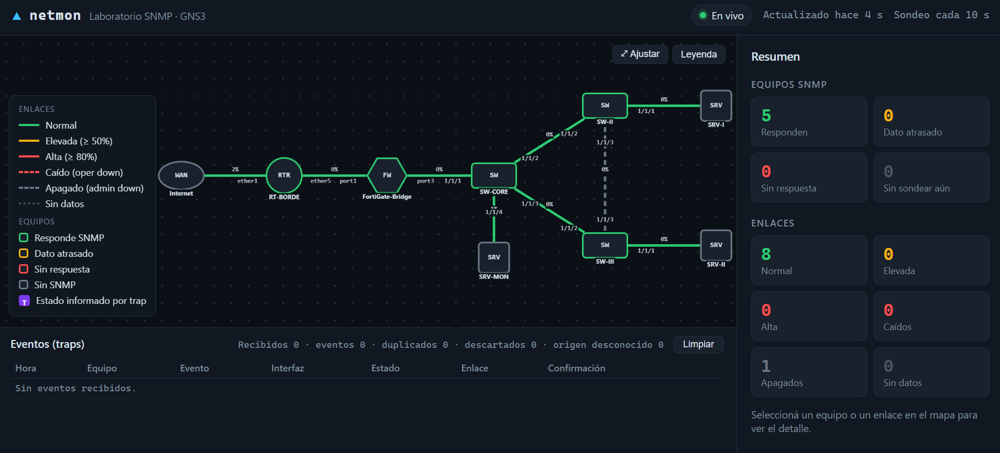

Se desarrolló y se probó sobre un laboratorio en **GNS3** con equipos **MikroTik**, **Fortinet** y **Aruba**, pero se puede adaptar a cualquier red que tenga equipos con SNMP.

---

## Contenido

1. [Qué hace](#qué-hace)
2. [Cómo funciona](#cómo-funciona)
3. [Laboratorio de referencia](#laboratorio-de-referencia)
4. [Requisitos](#requisitos)
5. [Paso 1: configurar SNMP en los equipos](#paso-1-configurar-snmp-en-los-equipos)
6. [Paso 2: verificar SNMP desde el servidor](#paso-2-verificar-snmp-desde-el-servidor)
7. [Paso 3: instalar netmon](#paso-3-instalar-netmon)
8. [Paso 4: armar el inventario](#paso-4-armar-el-inventario)
9. [Paso 5: dejarlo como servicio](#paso-5-dejarlo-como-servicio)
10. [Usar el dashboard](#usar-el-dashboard)
11. [MIB y OID utilizados](#mib-y-oid-utilizados)
12. [Particularidades encontradas por fabricante](#particularidades-encontradas-por-fabricante)
13. [Solución de problemas](#solución-de-problemas)
14. [Limitaciones y posibles mejoras](#limitaciones-y-posibles-mejoras)
15. [Estructura del repositorio](#estructura-del-repositorio)

---

## Qué hace

- **Mapa de la topología** con equipos y enlaces, definido en un archivo de inventario.
- **Estado y tráfico de cada interfaz** (IF-MIB), con el color del enlace según su utilización.
- **Recepción de traps** (linkDown, linkUp, coldStart, cambio de configuración) que actualizan el mapa al instante.
- **Confirmación de cada trap por sondeo**: después de un trap, vuelve a consultar el equipo y muestra si el estado real coincide.
- **CPU y memoria** de cada equipo, con la MIB que corresponda a cada fabricante.
- **Actualización en vivo** en el navegador (Server-Sent Events), sin recargar la página.
- **Línea de tiempo de eventos**, con detección de duplicados y de traps fuera de orden.

El sistema muestra el **estado actual**: no guarda historial de mediciones.

---

## Cómo funciona

netmon corre como un único servicio en un servidor Linux de la red (en el laboratorio, `SRV-MON`).

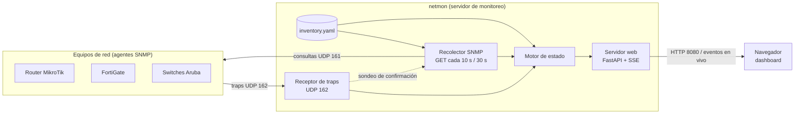

| Componente | Qué hace |
|---|---|
| **Inventario** (`config/inventory.yaml`) | Define los equipos, sus IP, los enlaces del mapa, qué interfaz (ifIndex) es cada extremo y los umbrales. |
| **Recolector SNMP** | Consulta cada equipo cada 10 s (estado y contadores de las interfaces) y cada 30 s (CPU y memoria). Cada equipo tiene su propio ciclo, así uno que no responde no demora a los demás. |
| **Receptor de traps** | Escucha en UDP 162, decodifica traps v1 y v2c, identifica el equipo por la IP de origen y la interfaz por el ifIndex. |
| **Motor de estado** | Combina inventario, consultas y traps y decide el estado de cada equipo y enlace. |
| **Servidor web** | Sirve el dashboard y envía cada cambio al navegador en cuanto ocurre. |

**Cálculo del tráfico.** SNMP no informa velocidades: informa **contadores de bytes acumulados**. netmon lee el contador dos veces y divide la diferencia por el tiempo transcurrido. Para medir ese tiempo usa el `sysUpTime` del propio equipo, y contempla el desborde del contador. 

---

## Laboratorio de referencia

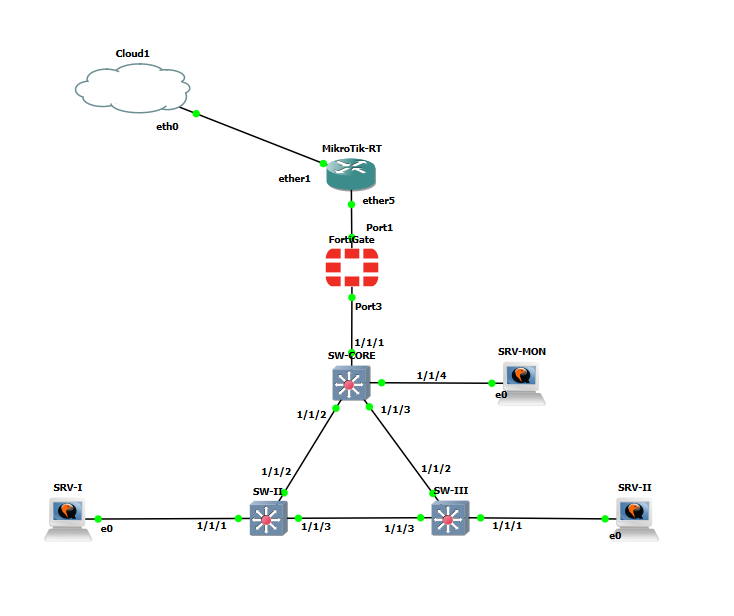

| Equipo | Software | Rol | IP de gestión |
|---|---|---|---|
| RT-BORDE | MikroTik CHR, RouterOS 7.22.1 | Router de borde (NAT, DHCP) | 192.168.50.1 |
| FortiGate-Bridge | FortiGate-VM, FortiOS 7.6.7 | Firewall en modo transparente | 192.168.50.2 |
| SW-CORE / SW-II / SW-III | ArubaOS-CX Virtual 10.15.0005 | Switches | 192.168.50.11 / .12 / .13 |
| SRV-MON | Ubuntu 24.04 | Servidor de monitoreo (netmon) | 192.168.50.20 |
| SRV-I / SRV-II | Ubuntu 24.04 | Generación de tráfico (iPerf3) | 192.168.50.200 / .199 |

Para sumar otros fabricantes, alcanza con agregarlo al inventario. Si se quieren CPU y memoria, también hay que sumar su perfil en `app/netmon/resources.py`.

---

## Requisitos

- Un servidor Linux con acceso a los equipos por UDP 161 y que los equipos puedan alcanzar por UDP 162. Se probó con **Ubuntu 24.04** y **Python 3.12**.
- Equipos con **SNMPv2c** habilitado.
- Herramientas Net-SNMP (`snmpget`, `snmpwalk`) para verificar los OID antes de cargar el inventario.
- Opcional: **iPerf3** en dos hosts, para generar tráfico de prueba.

---

## Paso 1: configurar SNMP en los equipos

En todos los fabricantes se sigue el mismo criterio:

- **SNMPv2c** con una community de **solo lectura**.
- Consultas permitidas **únicamente desde el servidor de monitoreo**.
- **Traps** enviados al servidor de monitoreo.

> ⚠️ En SNMPv2c la community viaja sin cifrar. No uses `public` y restringí siempre qué IP pueden consultar.

En los ejemplos, reemplazá `<COMMUNITY>` por tu community y `<IP_GESTOR>` por la IP del servidor donde corre netmon.

### MikroTik (RouterOS 7)

```routeros
/snmp community set [find name=public] disabled=yes
/snmp community add name=<COMMUNITY> addresses=<IP_GESTOR>/32 read-access=yes write-access=no
/snmp set enabled=yes contact="Monitoreo" location="Laboratorio" \
    trap-target=<IP_GESTOR> trap-community=<COMMUNITY> trap-version=2 \
    trap-generators=interfaces,start-trap trap-interfaces=all
```

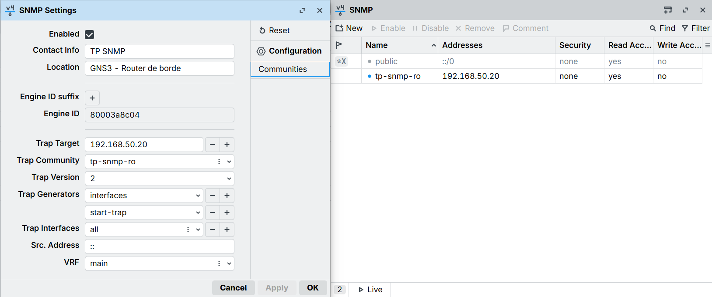

### FortiGate (FortiOS 7.6)

```
config system snmp sysinfo
    set status enable
    set description "FortiGate"
    set contact-info "Monitoreo"
    set location "Laboratorio"
end
config system snmp community
    edit 1
        set name "<COMMUNITY>"
        config hosts
            edit 1
                set ip <IP_GESTOR> 255.255.255.255
            next
        end
        set query-v1-status disable
        set trap-v1-status disable
    next
end
config system interface
    edit "port3"
        append allowaccess snmp
    next
end
```

En la interfaz por la que llega el servidor de monitoreo hay que permitir el acceso SNMP (`allowaccess snmp`). En el laboratorio es `port3`. `append` agrega el permiso sin borrar los que ya estén configurados.

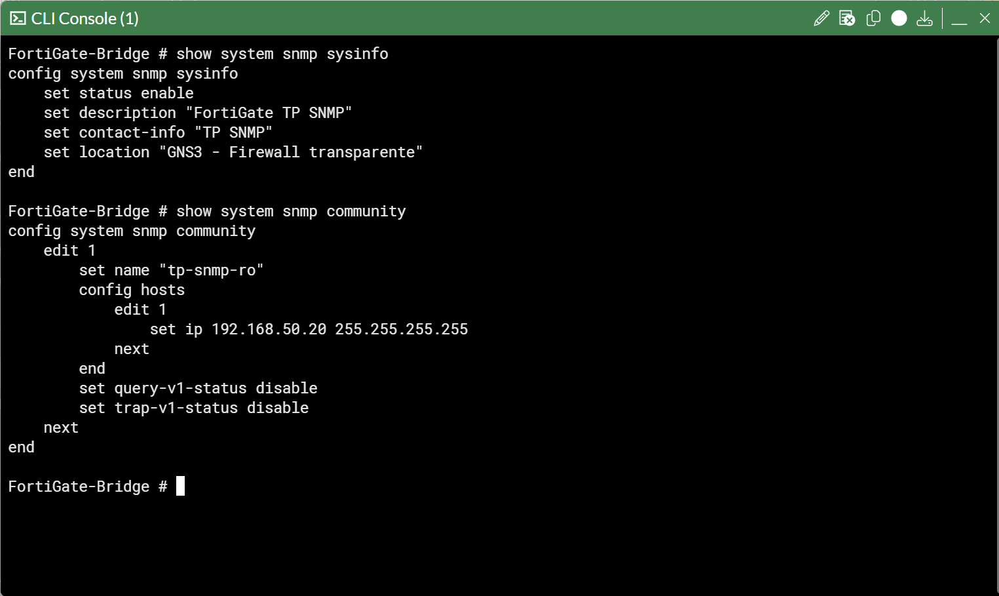

### Aruba AOS-CX (10.x)

```
configure terminal
access-list ip SNMP-MGMT
    10 permit any <IP_GESTOR> any
    exit
snmp-server vrf default
snmp-server system-location Laboratorio
snmp-server system-contact Monitoreo
snmp-server community <COMMUNITY>
    access-list ip SNMP-MGMT
    exit
snmp-server host <IP_GESTOR> trap version v2c community <COMMUNITY>
snmp-server trap configuration-changes
end
write memory
```

Ajustá el VRF según dónde esté la IP de gestión del switch. En el laboratorio es `default`, con la IP en `vlan1`.

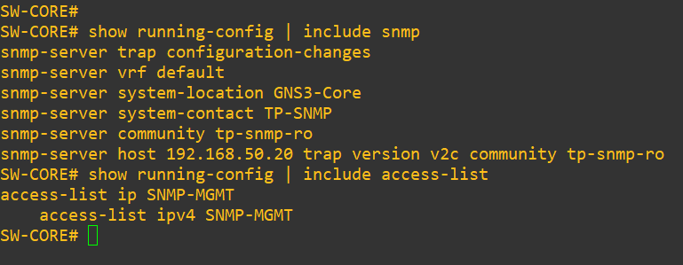

---

## Paso 2: verificar SNMP desde el servidor

Antes de instalar nada, conviene comprobar que cada equipo responde y averiguar sus **ifIndex**:

```bash
sudo apt update && sudo apt install -y snmp

# ¿Responde? (nombre y tiempo encendido)
snmpget -v2c -c <COMMUNITY> -On <IP_EQUIPO> 1.3.6.1.2.1.1.5.0 1.3.6.1.2.1.1.3.0

# Interfaces: ifIndex -> nombre
snmpwalk -v2c -c <COMMUNITY> <IP_EQUIPO> 1.3.6.1.2.1.31.1.1.1.1
```

La segunda consulta devuelve líneas como `ifName.2 = STRING: 1/1/2`: el número después del punto es el **ifIndex**, que después se usa en el inventario.

> Para que la community no quede en el historial de la terminal: `read -s -p "Community: " C; echo` y después usá `-c "$C"`.

---

## Paso 3: instalar netmon

En el servidor de monitoreo:

```bash
sudo apt install -y python3-venv git
sudo useradd --system --home /opt/netmon --shell /usr/sbin/nologin netmon

sudo git clone https://github.com/<usuario>/netmon-snmp.git /opt/netmon/src
sudo python3 -m venv /opt/netmon/venv
sudo /opt/netmon/venv/bin/pip install -r /opt/netmon/src/requirements.txt

# Código e inventario en las rutas que usa el servicio
sudo mkdir -p /opt/netmon/config
sudo cp -r /opt/netmon/src/app /opt/netmon/
sudo cp /opt/netmon/src/config/inventory.yaml /opt/netmon/config/

# Community en un archivo aparte, legible solo por root y el grupo netmon
sudo install -d -m 750 -o root -g netmon /etc/netmon
sudo install -m 640 -o root -g netmon /opt/netmon/src/deploy/netmon.env.example /etc/netmon/netmon.env
sudoedit /etc/netmon/netmon.env      # reemplazar CAMBIAR_POR_TU_COMMUNITY
```

La community **no va en el código ni en el inventario**: netmon la lee de `/etc/netmon/netmon.env`, o de la variable de entorno `NETMON_COMMUNITY`.

---

## Paso 4: armar el inventario

`config/inventory.yaml` describe la red. El archivo del repositorio es el del laboratorio de referencia y sirve de ejemplo.

```yaml
polling:
  interval_s: 10              # estado y tráfico de interfaces
  resources_interval_s: 30    # CPU y memoria

traps:
  port: 162                   # 0 = sin receptor de traps

thresholds:
  warning_pct: 50             # amarillo desde 50 %
  critical_pct: 80            # rojo desde 80 %
  default_capacity_bps: 3000000

devices:
  - id: sw-core               # identificador interno
    name: SW-CORE             # nombre en el mapa
    vendor: aruba             # aruba | fortinet | mikrotik | linux | cloud
    ip: 192.168.50.11
    snmp: {timeout_s: 5, retries: 2}   # null = equipo sin SNMP (solo se dibuja)
    pos: {x: 760, y: 0}       # posición en el mapa

links:
  - id: core-ii
    a: {device: sw-core, ifindex: 2}   # extremo A: equipo + ifIndex
    b: {device: sw-ii,   ifindex: 2}   # extremo B (ifindex: null si no tiene SNMP)
```

- **`vendor`** define cómo se consulta la CPU y la memoria. Para la parte de interfaces da igual el fabricante.
- **Cada enlace** se mide desde los dos extremos cuando ambos tienen SNMP. La utilización es la más alta de las dos.
- **`capacity_bps`** se puede definir por enlace. Si no se define, se usa `default_capacity_bps`.
- **`mem_total_mb`** (opcional) es la RAM total de un equipo que no la informa por SNMP. Se muestra con `*` para dejar claro que no es un dato medido.

### Capacidad de referencia y colores

El color del enlace depende de su **utilización**: el tráfico más alto medido dividido por la **capacidad de referencia**.

En un laboratorio virtual, la velocidad que informan las interfaces (1 Gbit/s) no tiene relación con lo que el simulador realmente transporta. Por eso la capacidad se define a mano. En este laboratorio se midió con iPerf3 que los paquetes empiezan a perderse cerca de **3 Mbit/s**, y ese valor se tomó como el 100 %:

| Tráfico generado | Utilización | Color |
|---|---|---|
| 1 Mbit/s | ≈ 33 % | 🟢 Verde (normal) |
| 2 Mbit/s | ≈ 67 % | 🟡 Amarillo (elevada) |
| 3 Mbit/s | ≈ 100 % | 🔴 Rojo (alta) |

En una red física, lo razonable es usar la velocidad real del enlace (por ejemplo, 1000000000 para 1 Gbit/s).

Para probar el inventario antes de crear el servicio (la community se toma de `/etc/netmon/netmon.env`):

```bash
cd /opt/netmon/app
sudo -u netmon /opt/netmon/venv/bin/python -m netmon.cli --cycles 3
```

Muestra por consola el estado de cada equipo y enlace durante 3 ciclos.

---

## Paso 5: dejarlo como servicio

```bash
sudo cp /opt/netmon/src/deploy/netmon.service /etc/systemd/system/
sudo systemctl daemon-reload
sudo systemctl enable --now netmon
systemctl status netmon --no-pager
ss -ltnup | grep -E ':8080|:162'
```

El servicio:

- corre con el usuario `netmon`, sin privilegios de administrador. Solo recibe la capacidad `CAP_NET_BIND_SERVICE`, para poder escuchar en el puerto 162;
- arranca solo cuando se enciende el servidor y se reinicia si falla;
- escucha en **8080/TCP** (dashboard) y **162/UDP** (traps).

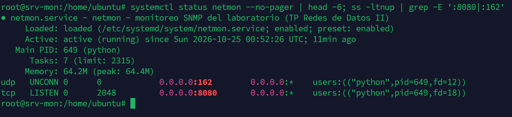

El dashboard queda en `http://<IP_GESTOR>:8080`.

> ⚠️ El dashboard no tiene autenticación. Está pensado para una red de laboratorio o de gestión aislada.

---

## Usar el dashboard

### Vista general

El mapa muestra los equipos y los enlaces. El **borde de cada equipo** indica si responde a SNMP (verde), si el último dato está atrasado (amarillo) o si no responde (rojo). Los equipos sin SNMP (servidores, Internet) se dibujan en gris. El botón **Leyenda** muestra el significado de cada color.

| Enlace | Significado |
|---|---|
| Verde / amarillo / rojo | Utilización normal, elevada o alta |
| Rojo punteado | Caído (la interfaz no tiene enlace) |
| Gris punteado | Apagado administrativamente (`shutdown`) |
| Línea de puntos | Sin datos (el equipo no responde) |

### Ficha de equipo y ficha de enlace

Al hacer clic en un **equipo** se abre su ficha: nombre y uptime (`SNMPv2-MIB`), tiempo de respuesta SNMP, **CPU y memoria**, y el estado y el tráfico de cada interfaz del mapa. La columna *Cont.* indica si el tráfico sale de contadores de 32 o de 64 bits.

Al hacer clic en un **enlace** se ven sus dos extremos por separado, cada uno con su estado y tráfico.

<p align="center">
  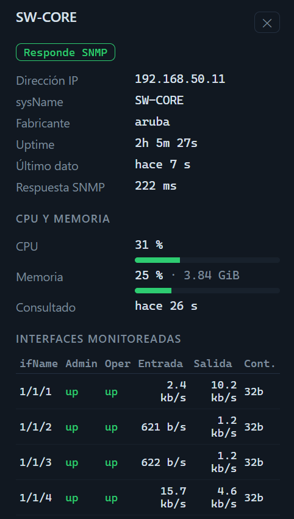
  &nbsp;
  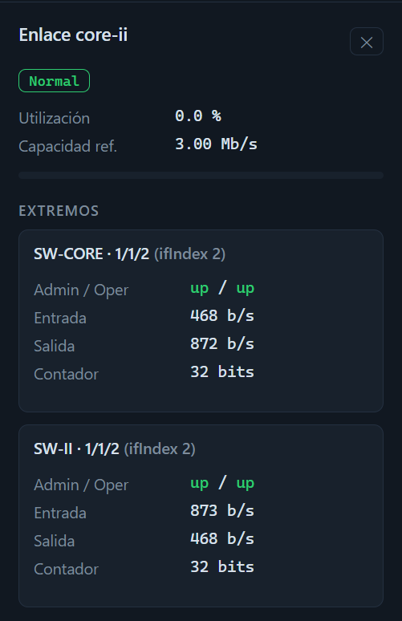
</p>

### Prueba de tráfico

Con iPerf3 en dos hosts se puede ver cómo cambian los colores:

```bash
# en el host destino
iperf3 -s
# en el host origen: 2 Mbit/s UDP durante 60 s
iperf3 -c <IP_DESTINO> -u -b 2M -t 60
```

En uno o dos ciclos, los enlaces del camino pasan a amarillo (≈ 67 % con una capacidad de 3 Mbit/s):

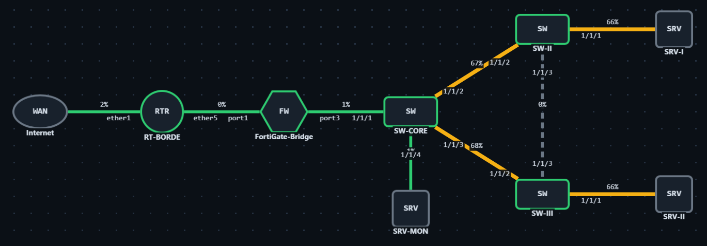

### Eventos (traps)

Debajo del mapa está la línea de tiempo con los traps recibidos: hora, equipo, tipo, interfaz, estado anterior y nuevo, y enlace afectado. Al hacer clic en una fila se ven los varbinds que trajo el trap. El botón **Limpiar** borra la lista y reinicia los contadores.

La columna **Confirmación** muestra el resultado de la consulta SNMP que netmon hace un segundo después de cada trap:

- **✓ sondeo coincide**: el estado real coincide con lo que informó el trap.
- **≠ sondeo difiere**: el estado real no coincide con el trap.
- **sin respuesta**: el equipo no respondió la consulta de confirmación.

Ejemplo con la interfaz de salida a Internet del MikroTik deshabilitada y vuelta a habilitar. La marca ×2 indica que cada trap llegó duplicado y se registró una sola vez:

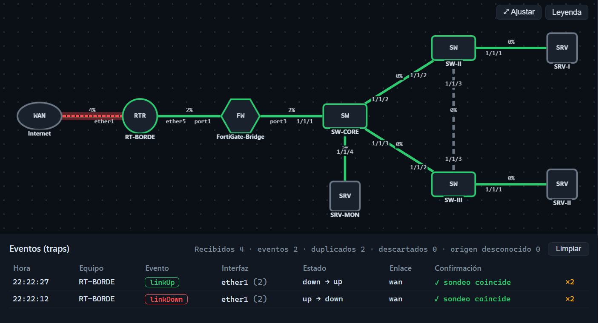

**Formas de generar traps para probar:**

- **MikroTik:** `/interface ethernet disable etherX` y después `enable`. Genera un linkDown y un linkUp.
- **Aruba:** cualquier cambio de configuración, por ejemplo una `description` en una interfaz, genera un trap de cambio de configuración, y netmon vuelve a consultar el switch en el momento.

> Si la interfaz que deshabilitás es la que conecta tu PC con el laboratorio, el navegador pierde la conexión mientras dure el corte. netmon igual recibe y registra los traps, y cuando la conexión vuelve, el navegador se reconecta solo y los muestra.

---

## MIB y OID utilizados

Todos los OID se usan en formato numérico, así que netmon **no necesita tener los archivos MIB instalados**. Las MIB solo sirven para identificar los objetos y probarlos con `snmpget`/`snmpwalk`. Las de Aruba y MikroTik se descargan de los sitios oficiales de cada fabricante, y las de Fortinet se pueden exportar desde el propio FortiGate.

| Información | Objetos | OID | MIB |
|---|---|---|---|
| Nombre / uptime | sysName, sysUpTime | `1.3.6.1.2.1.1.5.0` / `1.3.6.1.2.1.1.3.0` | SNMPv2-MIB |
| Nombre de interfaz | ifName | `1.3.6.1.2.1.31.1.1.1.1` | IF-MIB |
| Estado | ifAdminStatus, ifOperStatus | `1.3.6.1.2.1.2.2.1.7` / `1.3.6.1.2.1.2.2.1.8` | IF-MIB |
| Tráfico (32 bits) | ifInOctets, ifOutOctets | `1.3.6.1.2.1.2.2.1.10` / `1.3.6.1.2.1.2.2.1.16` | IF-MIB |
| Tráfico (64 bits) | ifHCInOctets, ifHCOutOctets | `1.3.6.1.2.1.31.1.1.1.6` / `1.3.6.1.2.1.31.1.1.1.10` | IF-MIB |
| CPU / memoria FortiGate | fgSysCpuUsage, fgSysMemUsage, fgSysMemCapacity | `1.3.6.1.4.1.12356.101.4.1.3.0` / `…4.1.4.0` / `…4.1.5.0` | FORTINET-FORTIGATE-MIB |
| CPU / memoria Aruba | arubaWiredSystemInfoCpu, arubaWiredSystemInfoMemory | columnas 3 y 4 de `1.3.6.1.4.1.47196.4.1.1.3.22.1.0.1.1` | ARUBAWIRED-SYSTEMINFO-MIB |
| RAM total (Aruba) | hrMemorySize | `1.3.6.1.2.1.25.2.2.0` | HOST-RESOURCES-MIB |
| CPU / memoria MikroTik | hrProcessorLoad, hrStorage (`main memory`) | `1.3.6.1.2.1.25.3.3.1.2` / `1.3.6.1.2.1.25.2.3.1` | HOST-RESOURCES-MIB |
| Traps de enlace | linkDown, linkUp | `1.3.6.1.6.3.1.1.5.3` / `1.3.6.1.6.3.1.1.5.4` | IF-MIB |
| Trap de configuración (Aruba) | arubaWiredConfigurationChangeNotification | `1.3.6.1.4.1.47196.4.1.1.3.20.0.1` | ARUBAWIRED-CONFIG-MIB |

---

## Particularidades encontradas por fabricante

Son comportamientos observados en las versiones del laboratorio de referencia. Pueden cambiar en otras versiones o en equipos físicos.

| Fabricante | Observación | Cómo lo resuelve netmon |
|---|---|---|
| Aruba CX (virtual) | Los contadores de 64 bits (`ifHC*`) devuelven siempre 0. | Usa los de 32 bits cuando los de 64 no avanzan. |
| Aruba CX (virtual) | No envía traps linkDown/linkUp, pero sí el de cambio de configuración. | Con ese trap dispara una consulta inmediata del switch. El estado de los enlaces se obtiene por sondeo. |
| Aruba CX (virtual) | Los contadores no se actualizan en cada consulta. Dos lecturas muy seguidas dan "0 b/s". | Solo calcula la tasa si pasaron al menos la mitad del intervalo entre lecturas. |
| MikroTik | Envía cada trap de enlace duplicado. | Junta los traps iguales que llegan dentro de 2 s (×2). |
| MikroTik | `snmpTrapAddress` no se puede usar para identificar el equipo. | Identifica el equipo por la IP de origen del paquete UDP. |
| MikroTik | A veces envía el linkUp antes de que la interfaz esté operativa. | La consulta de confirmación muestra el estado real ("sondeo difiere"). |
| Cada fabricante | CPU y memoria están en MIB distintas. | Un perfil por fabricante en `app/netmon/resources.py`. |

---

## Solución de problemas

| Síntoma | Qué revisar |
|---|---|
| El servicio no arranca | `journalctl -u netmon -n 50 --no-pager`. Lo más común: falta `/etc/netmon/netmon.env` o tiene permisos incorrectos. |
| Un equipo aparece "sin respuesta" | Probar `snmpget` desde el servidor. Revisar la community, la ACL o los hosts permitidos en el equipo, y en FortiGate el `allowaccess snmp`. |
| No llegan traps | `sudo tcpdump -ni any udp port 162`. Si llegan pero no aparecen, comprobar que la IP de origen sea la del inventario y que la community coincida (los traps con otra community se descartan y se cuentan como "descartados"). |
| Una interfaz aparece como "no existe" | El ifIndex del inventario no corresponde. Volver a consultar con `snmpwalk ... 1.3.6.1.2.1.31.1.1.1.1`. |
| El tráfico siempre da 0 | Puede que los contadores de 64 bits no avancen. Verificar `ifInOctets` y `ifHCInOctets` con `snmpget`. |
| El navegador muestra datos viejos después de actualizar | Recargar con Ctrl+F5. |

---

## Limitaciones y posibles mejoras

- Solo **SNMPv2c**. Pasar a **SNMPv3** agregaría autenticación por usuario y cifrado.
- **Sin historial**: el estado vive en memoria y se pierde al reiniciar el servicio.
- **Sin autenticación** en el dashboard.
- El mapa se define a mano en el inventario. Se podría descubrir con LLDP.

---

## Estructura del repositorio

```
netmon-snmp/
├── README.md
├── requirements.txt          # dependencias de Python (versiones probadas)
├── app/netmon/
│   ├── web.py                # servidor web (FastAPI) y eventos en vivo (SSE)
│   ├── engine.py             # ciclos de sondeo, traps y publicación del estado
│   ├── poller.py             # consulta SNMP por equipo y cálculo de tráfico
│   ├── traps.py              # receptor y decodificador de traps (v1/v2c)
│   ├── events.py             # línea de tiempo, duplicados y clasificación de traps
│   ├── resources.py          # CPU y memoria por fabricante
│   ├── state.py              # estado de equipos y enlaces
│   ├── snmp.py               # cliente SNMPv2c (GET / GETBULK) sobre pysnmp
│   ├── config.py             # lectura del inventario y de la community
│   ├── cli.py                # prueba por consola, sin interfaz web
│   └── static/               # dashboard (HTML, CSS, JS y Cytoscape.js)
├── config/inventory.yaml     # inventario del laboratorio de referencia (ejemplo)
├── deploy/
│   ├── netmon.service        # unidad de systemd
│   └── netmon.env.example    # plantilla para la community
└── docs/img/                 # capturas usadas en este README
```

**Tecnologías:** Python 3.12 · [pysnmp](https://github.com/lextudio/pysnmp) 7.1 · FastAPI · Uvicorn · [Cytoscape.js](https://js.cytoscape.org/) 3.30 (incluido en `static/vendor`, con su licencia MIT).
